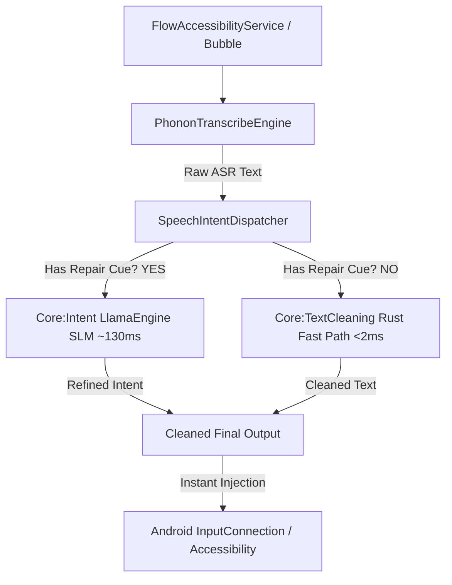

# Specification: On-Device Speech Intent & Self-Correction Engine

- **Author:** Antigravity / Devrith Architectural Co-Processor
- **Status:** Pending Review
- **Date:** 2026-10-31
- **Target Device:** Samsung Galaxy S23 Ultra (Snapdragon 8 Gen 2, 8GB RAM, `arm64-v8a`, Android 16)
- **Module:** `:core:intent` + Bundled Assets in `:app`

---

## 1. Context & Motivation

When speaking into voice dictation systems (Wispr Flow style), users frequently make natural speech repairs, slips of the tongue, and mid-sentence corrections:
- *"how about at 5pm no at 6"* $\rightarrow$ *"how about at 6pm"*
- *"let's grab lunch tomorrow wait Thursday"* $\rightarrow$ *"let's grab lunch Thursday"*
- *"send the deck to John actually Sarah"* $\rightarrow$ *"send the deck to Sarah"*

Standard Whisper/Phonon ASR models transcribe verbatim what was uttered, preserving stutters and abandoned thoughts. We are adding an **On-Device Speech Intent & Self-Correction Engine** using a lightweight Small Language Model (`SmolLM2-135M-Instruct` quantized to Q4_K_M, ~85MB) executed via `llama.cpp` on the device's CPU/NEON cores, bundled inside the APK alongside the Phonon-2 weights for zero-network, 100% offline, privacy-first dictation.

---

## 2. Requirements & Goals

1. **Self-Correction & Disfluency Resolution:**
   - Detect and resolve conversational repairs (times, dates, quantities, entity swaps, abandoned starts).
   - Produce natural, cleanly punctuated final text reflecting the speaker's true intent.
2. **Deterministic & Fast Execution (<180ms total):**
   - **Hybrid Dispatch:** Normal, fluent speech bypasses the SLM entirely and is processed in <2ms by the Rust text cleaner.
   - Only speech containing probable repair cues triggers the SLM.
   - SLM runs on NEON/fp16 with temperature 0.0, generating ~10-25 tokens in ~120-160ms on the Snapdragon 8 Gen 2 Cortex-X3.
3. **Bundled APK Delivery (Zero-Download):**
   - Bundle Phonon-2 (`model.fermion` ~169MB + `config.json`) and SmolLM2 (`smollm2-135m-instruct-q4_k_m.gguf` ~85MB) in `app/src/main/assets/models/`.
   - On first launch, `AssetModelExtractor` mirrors assets to `context.filesDir/models/` without user friction.
4. **Memory & Thermal Budget:**
   - Total runtime memory for Phonon-2 (~180MB) + SmolLM2 (~120MB) $\le$ 320MB RAM (<4% of the S23 Ultra's 8GB RAM).
   - Thread pool capped at 4 high-efficiency/performance cores to prevent throttling and battery drain.

---

## 3. Edge Cases & Handling Matrix

| Category | Example Input | Expected Output | Engine Route | Strategy / Edge Handling |
| :--- | :--- | :--- | :--- | :--- |
| **Time Correction** | *"how about at 5pm no at 6"* | *"how about at 6pm"* | SLM Intent | Repair cue *"no at"* identifies replacement of previous time token (*"5pm"*). |
| **Date Correction** | *"let's meet on Tuesday wait make it Wednesday"* | *"let's meet on Wednesday"* | SLM Intent | *"wait make it"* cancels *"Tuesday"*. |
| **Entity Swap** | *"send the email to David actually Sarah"* | *"send the email to Sarah"* | SLM Intent | *"actually"* replaces target recipient *"David"*. |
| **Number / Price** | *"that costs twenty five I mean thirty five dollars"* | *"that costs thirty five dollars"* | SLM Intent | *"I mean"* triggers numerical replacement. |
| **False Restart** | *"I wanted to ask if wait forget that let's order food"* | *"let's order food"* | SLM Intent | Full clause discard after *"forget that"*. |
| **Legitimate 'No'** | *"No I don't think we should do that"* | *"No, I don't think we should do that."* | Fast Path (Rust) | Leading *"No"* followed by pronoun is a direct statement, not a repair cue. Bypasses SLM. |
| **Legitimate 'Wait'** | *"Please wait for me at the front door"* | *"Please wait for me at the front door."* | Fast Path (Rust) | Verb *"wait for"* detected by heuristic grammar; bypasses SLM. |
| **Legitimate 'Actually'** | *"That movie was actually incredible"* | *"That movie was actually incredible."* | Fast Path (Rust) | Adverbial modifier without conflicting antecedent; bypasses SLM. |
| **Code / Acronyms** | *"run git commit dash m update"* | *"run git commit -m update"* | Fast Path (Rust) | Technical phrasing; text-cleaner handles flags and terms. |
| **Long Speech (>40 words)** | Complex 3-sentence dictation with one repair in sentence 2 | Sentence-level split repair | SLM per clause | Split by clause/sentence boundaries to prevent context blowup and keep latency <150ms. |

---

## 4. Architecture & Module Design

### 4.1 Multi-Module Layout


### 4.2 `:core:intent` Module Spec
- **Path:** `core/intent/`
- **Native Implementation (`CMake`):**
  - Uses `llama.cpp` core static libraries (`libllama.a`, `libggml.a`, `libggml-cpu.a`).
  - Target ABI: `arm64-v8a` with `__ARM_NEON`, `__ARM_FEATURE_FP16_VECTOR_ARITHMETIC`.
  - Minimal JNI bridge: `intent_jni.cpp` providing:
    - `nativeInit(modelPath: String, nThreads: Int): Long`
    - `nativeRepair(handle: Long, text: String, maxTokens: Int): String`
    - `nativeRelease(handle: Long)`
- **Prompt Engineering for SmolLM2-135M-Instruct:**
```text
<|im_start|>system
You are a speech disfluency and self-correction repair engine. Convert spoken speech containing false starts, self-corrections, or slips of the tongue into the clean intended text. Preserve exact intent, casing, and names. Output ONLY the corrected text with no commentary or quotes.<|im_end|>
<|im_start|>user
Input: "call me at 5 no 6pm"
Output: Call me at 6pm.
Input: "send the files to Alex wait to Bob"
Output: Send the files to Bob.
Input: "{INPUT_TEXT}"
Output:<|im_end|>
<|im_start|>assistant
```
- **Sampling Settings:**
  - `temperature`: 0.0 (strictly deterministic greedy decoding).
  - `top_p`: 1.0
  - `stop_sequences`: `["<|im_end|>", "\n", "Input:"]`
  - Max generated tokens: `input_token_count + 16`.

### 4.3 Asset Packaging & First-Launch Pipeline
- Directory: `app/src/main/assets/models/`
  - `models/phonon2/model.fermion` (169 MB)
  - `models/phonon2/config.json` (1.2 KB)
  - `models/intent/smollm2-135m-q4_k_m.gguf` (85 MB)
- `AssetModelExtractor`:
  - Runs in a background Coroutine (`Dispatchers.IO`) during splash or bubble service initialization.
  - Checks if destination files exist and match CRC32/size; skips re-extraction if present.
  - Extracts to `context.filesDir.resolve("models/...")`.
  - Exposes `isReady: StateFlow<Boolean>` so UI and dictation know model readiness.

---

## 5. Alternatives Considered

1. **Pure Regex / Rule-based Grammar (Alternative 1):**
   - *Pros:* Zero extra MB, <1ms.
   - *Cons:* Brittle on natural English variations (e.g., *"actually wait no make that 7"* vs *"no wait, 7"*). Fails on semantic entity replacements.
2. **Cloud API (Whisper/GPT-4o mini) (Alternative 2):**
   - *Pros:* High reasoning ability.
   - *Cons:* Violates user requirement for 100% offline private dictation; adds 600-1500ms network latency.
3. **Approach 1 Selected:** On-device 135M SLM hybrid execution offers the perfect sweet spot: zero cloud, <180ms latency, high grammatical fidelity, and trivial memory footprint on an 8GB phone.

---

## 6. Verification & Test Plan

1. **Unit Tests (`BubblePlacementTest`, `IntentRepairTest`):**
   - Test `SpeechIntentClassifier`: verify 100% precision on true repairs and 0% false positives on legitimate sentences with *"no"*, *"wait"*, *"actually"*.
   - Test edge-cases: time expressions, dates, punctuation, empty text, single words.
2. **Devrith Architectural Preflight:**
   - Execute `arch-sidecar feature "speech-intent" . --verify` to ensure AST integrity, no circular imports, and strict lexical scope compliance.
3. **Hardware Verification on S23 Ultra (`adb`):**
   - Build APK with bundled models (`./gradlew assembleDebug`).
   - Push and install to `RZCW21BJDWX`.
   - Measure asset extraction time on clean install.
   - Perform live voice benchmark: record *"how about at 5pm no at 6"* and assert injected text is *"How about at 6pm."* in under 250ms total turn-around.
